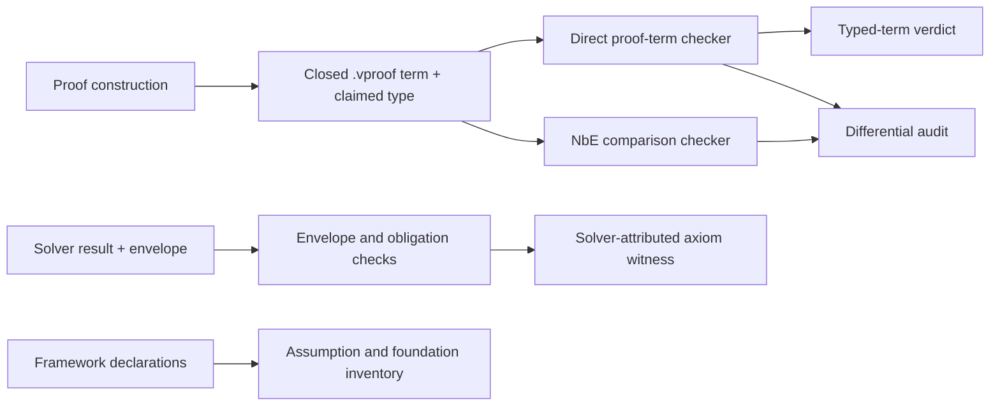

# Kernel Trust Boundaries

Verum separates proof construction from proof checking. The boundary is
an executable contract: a particular checker accepts a particular term
at a particular type. The name `verum_kernel` alone does not identify
that contract; the crate contains both the small proof-term calculus and
a broader collection of verification and audit mechanisms.

The architectural goal is a systems language in which proofs, executable
programs and explicit assumptions remain connected. A dependable connection
requires distinguishing the following surfaces.

| Surface | Input and authority | What acceptance establishes |
|---|---|---|
| `proof_checker::Certificate::verify` | Closed `Term` and `claimed_type` | The pair passes the implemented dependent-function, pair, identity and ordinary-induction rules |
| `proof_checker_nbe::verify_certificate` | The same certificate language | A second checking algorithm gives its verdict on the same pair |
| `infer` / `verify_full` | Broader `CoreTerm`, context and registries | Acceptance under that API's rules and registered assumptions |
| `replay_smt_cert_with_obligation` | SMT envelope and expected obligation hash | Envelope checks and goal association; the current witness is a solver-attributed axiom |
| Audit registries | Rule manifests, citations and declared requirements | Recorded dependencies and policy checks, with their declared coverage |

Sources: [`proof_checker.rs`](https://github.com/verum-lang/verum/blob/main/crates/verum_kernel/src/proof_checker.rs),
[`infer.rs`](https://github.com/verum-lang/verum/blob/main/crates/verum_kernel/src/infer.rs),
[`support.rs`](https://github.com/verum-lang/verum/blob/main/crates/verum_kernel/src/support.rs).

## Where the kernel sits



For the minimal certificate route, tactic search and elaboration need not
be trusted to produce well-typed terms: the result is checked again.
However, checking a term does not establish that its claimed type is the
statement the user intended. Binding source statements, imported definitions
and certificates is a separate obligation of the producer and consumer.

The AST-to-minimal-goal bridge explicitly refuses theorem parameters and
`requires` clauses, source function contracts and source refinement types.
These routes return `UnsupportedExpression` before constructing a kernel
goal. Explicit formal `VerificationGoal` inputs remain a separate API. See the [source-to-goal boundary](../verification/knowledge-systems.md#source-to-goal-boundary)
for the accepted fragment and refusal outcomes.

## The CoreTerm calculus

Two term languages have distinct roles:

- **`proof_checker::Term`** uses de Bruijn indices, universe-level
  expressions, dependent functions and pairs, identity types, reflexivity
  and an endpoint-indexed transport eliminator. It also carries complete
  first-order datatype declarations with dependent fields, owned constructors,
  induction and checked
  local definitions. It has no arbitrary `Axiom`, SMT, refinement or cubical
  constructor.
- **`term::CoreTerm`** is the broader named-binder representation used by
  the elaboration and verification infrastructure. It also represents
  refinements, cubical operations, quotients, inductives, modalities and
  registered axioms. A constructor's presence is not a proof that every
  surface-language use lowers to the minimal certificate language.

See the [proof-term rule reference](../verification/trusted-kernel.md)
for the accepted fragment. Consumers must name which calculus a stored
artifact uses; the two cannot be interchanged by changing a format label.

## Typing rules

The minimal certificate checker starts from an empty context. It validates
the claimed type, infers the proof term's type, then checks conversion.
Universe levels and dependent substitutions are part of this check.
An accepted open-context judgment is conditional on that context; it is
not a closed theorem until its assumptions are discharged or abstracted.

The named `verify_full` receives an axiom registry; `verify_with_inductives`
also receives an inductive registry. Their trust boundaries include the
checked declarations and explicit assumptions used by those routes. A successful registry audit is not a replacement for
checking a particular proof against its complete statement.

## The substitute function

The minimal checker implements capture avoidance through de Bruijn
shifting and substitution. The broader `CoreTerm` implementation uses
named binders and fresh-name generation. The algorithms operate on
different carriers and are tested separately.

A substitution test can detect a concrete implementation defect. A complete
metatheoretic preservation theorem would additionally relate all admissible
inputs, contexts and reductions. These are different forms of evidence.

## Definitional equality

Conversion depends on the chosen checker and the environment available to
it. The broader normalizer can unfold transparent registry definitions
when supplied with their registry; an opaque axiom remains opaque. Thus
adding a registry may enable equalities that a registry-free call cannot
establish. Shared normalization code does not make the entry points
interchangeable.

A bounded checker may fail to complete a conversion. Consumers must retain
that resource outcome rather than infer that the proposition is false.
The [knowledge-system profile](../verification/knowledge-systems.md)
specifies how to keep this distinction in stored verification evidence.

## `AxiomRegistry`

The registry records named declarations, declared types and framework
attribution. Transparent definitions and opaque assumptions have different
roles: a definition has a body to check; a postulate extends what may be
assumed. A bibliographic reference describes an assumption's provenance,
not a proof term establishing that assumption.

Foundation-profile classification can expose declared incompatibilities
and unresolved citations. It does not prove relative consistency or
construct a faithful interpretation between arbitrary foundations.

## The SMT certificate

`SmtCertificate` carries an envelope version, backend identity, trace bytes,
obligation hash and diagnostic metadata. In
`support.rs::replay_smt_cert`, the checker validates the envelope, recognizes
a backend and first rule tag, and constructs a `CoreTerm::Axiom` attributed
to that backend. It does not reconstruct every inference of a native Z3
proof or an Alethe derivation.

`replay_smt_cert_with_obligation` additionally compares the supplied expected
hash. This prevents accepting an envelope for a different named obligation;
it does not establish that the solver's answer is correct. The producer,
translation and solver remain trusted for this route's substantive claim.
The expected hash must come from the consuming goal, not from the certificate
itself.

Removing that trust requires checked rule-by-rule reconstruction, or a
separate verified decision procedure whose input is the exact obligation.
The current attributed witness should be stored as solver evidence with
its assumptions, not relabelled as a minimal `.vproof` derivation.

## TCB enumeration

For a closed minimal certificate, the execution boundary includes the
chosen checker, certificate decoder, host toolchain/runtime and machine.
The meaning boundary additionally includes the correspondence between
`claimed_type` and the user's intended statement.

Broader routes add their own assumptions: registries, solver attestations,
foreign proof assumptions or compilation semantics. Keep these dependencies
attached to the result. Self-hosting changes the implementation language;
it does not by itself remove compiler trust or establish consistency.

`KernelV0Kernel` calls the direct certificate checker before inspecting
its bootstrap manifest and declared metatheory requirements. It therefore
adds policy checks, rather than an independent third term-checking algorithm.
See [differential verification](../verification/two-kernel-architecture.md).

## Test coverage

Run from a Verum language checkout:

```bash
cargo test -p verum_kernel --lib
verum audit --proof-term-library --format json
verum audit --differential-kernel --format json
```

The audit commands use the `verum` binary on the selected path. Record its
identity and keep positive and rejecting controls with the report. A passing
suite gives evidence for exercised cases; a clean manifest or agreement
between checkers is not a proof of the complete implementation's soundness.

## See also

- [Knowledge-system verification profile](../verification/knowledge-systems.md)
  — reproducible checks and a Noesis integration contract.
- [Trusted proof-term checker](../verification/trusted-kernel.md)
  — rules, certificate language and limits.
- [External-prover verification](./external-prover-verification.md)
  — what foreign-tool acceptance establishes.
- [Verification pipeline](./verification-pipeline.md)
  — compiler-facing integration.
