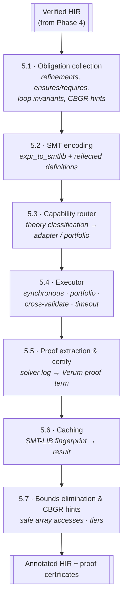

# Verification Pipeline

This page documents the internal architecture of Verum's **SMT
verification subsystem** for compiler developers. The subsystem has
two invocation points in the compilation pipeline:

:::note Solver choice is an implementation detail
The language layer talks to an abstract SMT backend. The current
release dispatches to one or more solver adapters through the capability
router; a Verum-native solver is on the roadmap. Specific solver names
below are notes about the current implementation, not part of Verum's
language contract.
:::

- **Phase 3a — contract verification** — discharges
  `contract#"..."` literals before the type checker sees the
  annotated function.
- **Phase 4 — refinement / dependent verification** — runs as a
  sub-step of semantic analysis (the `DependentVerifier`), collecting
  refinement-type obligations, `ensures` / `requires` clauses, and
  loop invariants.

Results from both flow into Phase 5 VBC codegen as tier-promotion
and bounds-elimination hints. For the user-facing model, see
**[Gradual verification](/docs/verification/gradual-verification)**;
for the solver-selection policy, see **[SMT routing](/docs/verification/smt-routing)**.

## Sub-phase overview

The internal numbering (5.1–5.7) below is the subsystem's own
internal stages — the solver work, not the public pipeline phases.

| Sub-phase | Stage                         | Summary                                                                     |
|-----------|-------------------------------|-----------------------------------------------------------------------------|
| **5.1**   | Obligation collection         | refinement types, `requires` / `ensures`, loop invariants, CBGR hints       |
| **5.2**   | SMT encoding                  | `verum_smt::expr_to_smtlib` + reflected-definition injection                |
| **5.3**   | Capability router             | theory classification → adapter / portfolio                                 |
| **5.4**   | Executor                      | synchronous / portfolio / cross-validate, per-obligation timeout            |
| **5.5**   | Proof extraction & certify    | solver log → Verum proof term (machine-checked if `@verify(certified)`)     |
| **5.6**   | Caching                       | SMT-LIB fingerprint → result, `target/smt-cache/`                           |
| **5.7**   | Bounds elim. & CBGR hints     | inform Phase 6 about provably-safe array accesses and reference tiers       |



## 5.1 — Obligation collection

Walks the typed HIR and emits one `VerificationObligation` per
logical claim that must hold:

Each `VerificationObligation` carries an identifier, a kind, the
in-scope bindings that form its context, a goal predicate, the
source span it was emitted from, and a verify mode (`runtime` /
`static` / `smt` / `portfolio` / `certified`).

The `ObligationKind` enumeration covers every reason an
obligation can be raised:

| Kind                       | Source |
|----------------------------|--------|
| `RefinementWellFormed`     | A refinement type such as `Int { self > 0 }`. |
| `RefinementSubsumption`    | A narrowing / subtyping boundary. |
| `Precondition`             | A `where requires` clause. |
| `Postcondition`            | A `where ensures` clause. |
| `LoopInvariant`            | An `invariant` clause. |
| `LoopTermination`          | A `decreases` clause. |
| `ArrayBounds`              | An `xs[i]` access with non-trivial index. |
| `ContextCapability`        | A capability-subsumption check. |
| `ReferencePromotion`       | Tier-promotion query (`&T → &checked T`). |
| `PatternExhaustiveness`    | A `match` completeness check. |

Sources: `verum_compiler::phases::verification_phase::collect_obligations`
plus hooks in `verum_types::infer` that emit obligations during flow
analysis.

## 5.2 — SMT encoding

`verum_smt::expr_to_smtlib` translates Verum expressions to SMT-LIB
2.6. The translator handles:

- Primitive types → SMT sorts (`Int`, `Real`, `Bool`, `Bitvector N`).
- Algebraic data types → SMT `declare-datatypes`.
- Reflected predicates → `declare-fun` plus a universally-quantified
  defining axiom (no recursive encoding).
- Generic instantiations → monomorphised SMT sorts.
- Cubical / path types → projected to their computational content.

reflected definition injection: the subset of reflected functions reachable from
the current obligation is collected (via transitive closure), and
their bodies emitted as `(define-fun-rec …)` before the obligation's
`(assert (not goal))`.

## 5.3 — Capability router

`verum_smt::capability_router` classifies each obligation by
theory usage. The classifier walks the goal AST and tags it
with the theories it touches; the router then maps the theory
set to an adapter choice.

| AST shape encountered            | Theory tag added |
|----------------------------------|------------------|
| Add / Sub / Mul                  | LIA              |
| Mul of two non-constants         | NIA (nonlinear)  |
| Bit-and / Bit-or / Shift         | BV               |
| Index / Length                   | Array            |
| Concat / Matches                 | String           |
| Forall / Exists                  | Quantifier       |

The mapping from the resulting tag set to an adapter choice
follows the rules below. The router does not name any specific
solver — it picks the highest-ranked adapter whose declared
capabilities cover the tag set. When portfolio mode is in
effect, several adapters race against each other.

| Tag set                                          | Adapter choice |
|--------------------------------------------------|----------------|
| Subset of `LIA ∪ BV ∪ Array ∪ Quantifier`         | Adapter strongest on linear arithmetic. |
| Contains `String` or `NIA`                       | Adapter strongest on those theories. |
| Contains `FiniteModelFinding`                     | Adapter advertising finite-model finding. |
| Otherwise (and portfolio mode on)                 | Race the available adapters in parallel. |
| Otherwise                                         | Default-ranked adapter. |

## 5.4 — Executor

Three execution strategies:

| Mode | Behaviour | Trigger |
|---|---|---|
| **Single** | Dispatch to the router's choice of solver; wait for result | `@verify(formal)` |
| **Portfolio** | Both solvers plus proof search in parallel; first answer wins | `@verify(thorough)` / `@verify(reliable)` |
| **Cross-validate** | Portfolio plus an orthogonal technique; require agreement; error on disagreement | `@verify(certified)` |

Timeout: default 5 s per obligation, configurable via
`verum.toml [verify] solver_timeout_ms`. On timeout, the fallback
strategy (`other-solver` by default) retries with the non-preferred
solver.

## 5.5 — Proof extraction & certification

For `@verify(certified)` obligations:

1. The solver is asked to emit a proof log (`(set-option :produce-proofs true)`).
2. The log is parsed into an AST of inference steps.
3. Steps are normalised into Verum's `ProofTerm` enum:

```verum
type ProofTerm is
    | ByAssumption(obligation_id: UInt64)
    | ByReflexivity
    | BySymmetry(Heap<ProofTerm>)
    | ByTransitivity { left: Heap<ProofTerm>, right: Heap<ProofTerm> }
    | ByInduction    { base: Heap<ProofTerm>, step: Heap<ProofTerm> }
    | ByTactic       { name: Text, args: List<ProofTerm> }
    | ByAxiom        { axiom: Text }
    | BySubst        { lhs: Expr, rhs: Expr, proof: Heap<ProofTerm> }
    | ByCase         { scrutinee: Expr, arms: List<ProofTerm> };
```

4. A verifier checks each step against the axioms + context — this is
   the machine check.
5. On success, the proof term is serialised into the VBC archive's
   `proof_certificates` section.

**Proof erasure** (default, controlled by `[codegen] proof_erasure`):
proof terms are marked and stripped before Phase 5 VBC codegen. The
final binary carries **no runtime proof verification cost** — only
metadata required to reconstruct proofs offline.

## 5.6 — Caching

**Key**: SHA-256 of the SMT-LIB query text plus the solver version
tuple.

**Storage**: `target/smt-cache/`, one file per obligation, value is
`Result` (sat / unsat / unknown / timeout) plus optional proof blob.

**Invalidation**:
- Obligation text change → new hash, no hit.
- Solver upgrade → version-tuple mismatch, invalidate.
- Manual: delete `target/.verum-cache/smt/` or run `verum clean --all`.

Observed hit rate: 60–70% on typical incremental builds.

## 5.7 — Bounds elimination & CBGR hints

Verifier results feed forward into Phase 5 VBC codegen and Phase 6
monomorphization:

- **Array-bounds elimination**: if the solver proves `i < xs.len()`
  for every call site, the bounds check is removed before codegen.
- **Reference-tier promotion**: if escape analysis + refinement
  results prove a `&T` reference is never stored beyond its scope,
  it's promoted to `&checked T` — codegen emits `RefChecked` instead
  of `Ref`, zero-cost.
- **Capability elision**: a `Database with [Read]` that never reaches
  a `Write`-requiring method skips the capability check.

The subsystem's output carries a `HintTable` consumed by VBC codegen
and by later refinement-aware passes (`passes/cbgr_integration.rs`).

## Performance

Empirical on a 50 K-LOC mixed project, Apple M3 Max:

| Theory mix       | Count | Median (ms) |  p95 | Adapter dispatch |
|------------------|------:|------------:|-----:|------------------|
| LIA only         | 2 100 |           8 |   35 | linear-arithmetic adapter |
| LIA + bitvector  |   940 |          14 |   60 | linear-arithmetic adapter |
| LIA + string     |   110 |          45 |  180 | string-capable adapter    |
| Nonlinear (NIA)  |    42 |         320 | 1800 | nonlinear-capable adapter |
| Cubical / path   |    18 |         120 |  400 | cubical tactic → SMT layer |
| **overall**      | 3 210 |          12 |   85 | — |

## Telemetry

`VERUM_SMT_TELEMETRY=1` emits a JSONL stream to
`.verum/telemetry/routing.jsonl`:

```json
{"obligation": "search/postcond#3", "theories": ["lia","array"], "routed": "primary", "ms": 8, "result": "unsat"}
{"obligation": "parse/postcond#1", "theories": ["lia","string"], "routed": "string-capable", "ms": 72, "result": "unsat"}
{"obligation": "crypto/invariant#7", "theories": ["lia","bv"], "routed": "portfolio", "primary_ms": 20, "complementary_ms": 35, "agreed": true}
```

Used to tune the capability router and to detect regressions across
solver upgrades.

## Trusted kernel

Verification has distinct checking paths. The named `CoreTerm` calculus is
checked by `verum_kernel`; portable certificates use the smaller `verum_proof`
calculus with direct and normalization-by-evaluation checkers. Independent Lean
replay covers selected portable certificate forms. A successful check in one
representation does not establish coverage of the other.

### Checking APIs

| Entry point | Role |
|-------------|------|
| `infer` | Infer a named term's type from its context and axiom registry. |
| `verify_full` | Check goal formation and compare the proof type with the goal in the inductive-free fragment. |
| `infer_with_inductives` | Infer with an explicit registry of inductive declarations. |
| `verify_with_inductives` | Check goal formation and a proof against that registry. |
| `replay_smt_cert` | Reconstruct a supported certificate's witness; a solver verdict alone is insufficient. |

Ordinary inductive elimination checks the complete branch family, constructor
ownership, parameter instantiation and recursive hypotheses. Constructors carry
their owning declaration; a local variable with the same spelling is not a
constructor. Recursive fields come from the declaration before parameter
substitution. Nested recursion requires strict positivity checked from the
container's definition, rather than assumed from its name.

Type conversion preserves lexical binding and distinguishes free variables from
bound ones. Type parameters and constructor fields must respect the declaration's
universe. The declaration schema does not yet provide a separate universe
parameter telescope for every datatype parameter.

Declarations are checked before admission. Transparent definitions must have
closed, well-typed bodies at their declared types. Mutually dependent inductives
are admitted atomically after checking field types, universe bounds, parameter
scope and strict positivity against every member of the group. Unknown type
names are errors. Registries retain dependency identities and reject a later
environment that replaces a dependency with another declaration of the same name.

Quotient elimination supports relation-respecting maps into a constant result
type. `QuotElim` carries an explicit `respect` proof: related inputs must produce
equal outputs. Formation, introduction, the case function and that proof are
checked in the kernel. A genuinely dependent quotient motive is refused until
dependent transport coherence is supported. Ordinary transport checks that the
path relates types and that the value inhabits its source type.

### Trusted computing base

A proof claim depends on the checker actually invoked, its implementation and
runtime, and any assumptions supplied through its context or axiom registry.
Independent replay adds a separate check only for the exact statement and
certificate representation it accepts. The Rust compiler, linked dependencies
and execution environment remain part of the native checking boundary.

Tactics, elaboration and solver search are intended to produce evidence for
checking. Their output, an audit entry, or a reconstructed diagnostic proof tree
is not itself proof acceptance. See [proof honesty](/docs/verification/proof-honesty)
for the distinction between evidence and audit metadata.

### Current limitations

Higher inductive elimination is refused because the named-term API does not yet
check the required path-coherence evidence. Its declaration and signature data
must not be interpreted as an accepted higher inductive proof.

The portable certificate calculus supports first-order inductive declarations,
owned constructors, dependent induction and transparent local definitions.
Its substitution and normalization-by-evaluation checkers and the independent
Lean reference checker replay this fragment. Direct recursive fields receive
explicit induction hypotheses. Constructor field types may depend on preceding
fields; construction substitutes their actual values, and induction preserves
those dependencies while inserting recursive hypotheses. Self references and
forward references in field types are rejected. Indexed families carry a checked
index telescope, constructor result indices and direct recursive fields at
explicit indices. Their induction motives quantify over both indices and values.
Mutually recursive groups and nested or function-valued recursion remain outside
this portable fragment. Named declarations must be translated and checked; they do
not become portable certificates automatically. General dependent-record
elimination and altered-evidence controls are replayed by
`verification/certificates/check_dependent_constructors.py`. General indexed
vector-length preservation and malformed-index controls are replayed by
`verification/certificates/check_indexed_induction.py`.

Dependent pair introduction uses the expected family: for a goal
`Σ(y : A). B(y)`, the checker verifies the first value at `A` and the second
at `B(first)`. This expected type propagates through functions, arguments,
constructor fields, induction branches and identity elimination. A witness
paired with evidence about a different value is rejected. The portable
substitution and normalization-by-evaluation algorithms and the independent
Lean replay check these rules. This does not establish full checker soundness
or extend the supported inductive declaration grammar.

Expected families also reach introductions through transparent local definitions,
including alias chains and uses beneath later binders. Each definition is checked
before use, even when unused. This does not refine the declared type of an
arbitrary function result or a context assumption: those retain their stated
types. Normalizing an unchecked expression would erase relevant obligations.

The Lean reference checker uses total operations for binder traversal,
substitution and fuel-bounded weak-head reduction. General proofs establish
traversal composition, lifting/lowering cancellation and substitution after
inserting a fresh binder, including nested datatype fields. These proofs concern
the executable term operations; typing preservation, the complete checking
algorithm and correspondence to the Rust implementation remain separate
obligations. The proof module is `VerumExternalReplay.TermOperations`.

`VerumExternalReplay.TermScope` proves scope preservation under context
extension, lifting and substitution, and that every certificate accepted by the
reference verifier has a closed proof and goal. Native admission and independent
replay check scope before normalization. Scope establishes that variables are
bound; it does not establish typing or logical soundness.

`VerumExternalReplay.ReductionScope` proves that every fuel-bounded weak-head
reduction preserves scope, including constructor induction and truncated runs.
`VerumExternalReplay.ReductionSemantics` connects every evaluator result to a
finite sequence of explicit beta, let, projection, identity-transport and
induction steps. The rules do not assume evaluator correctness. Fuel exhaustion
can leave a reducible term, so reachability does not imply normality. These
results do not yet establish typing preservation or Rust-checker correspondence.

Execution-policy certificates also check conditional action and continuation
identity, foreign-queue preservation, refusal of credit after error or unwind,
and receipt preservation through interpretation. Failed interpretation remains
inadmissible after later transformations. Transport confirmation and eligibility
for outcome credit are distinct facts. These are general laws of the explicit
policy model, checked alongside altered-policy rejection controls; correspondence
to application code, affine consumption, adapter fidelity and durable delivery
remain separate obligations. The reproducible entry point is
`verification/certificates/check_dispatch_contract.py`.

Candidate-support locality is checked as a separate conditional contract. At a
fixed valid candidate, preserving membership and support witnesses on a nonempty
admitted domain preserves that same domain's admission. Time and event support
may have different witnesses. Selection from the eligible set retains membership
in the full situation universe; identity comparison requires the same domain and
scoring context. These predicate-level laws do not prove arithmetic thresholds,
statistical confidence, optimizer completeness or application correspondence.
Expanding the full universe can change selection cost. The reproducible checker
entry point is `verification/certificates/check_candidate_locality.py`.

General finite execution and observation preservation are checked using this
fragment. The statement requires step commutation at every executed admissible
action and preserves visited states, termination and refusal payloads. It does
not establish program selection, learning, actual external effects, or the
correspondence of an arbitrary implementation to those premises. See
[general trace certificates](/docs/architecture/differential-lean-checker#general-trace-certificates).

Retrospective initialization has a constructive criterion: on every occupied
reachable-history fibre, the queried state has a unique compatible value if and
only if the query is constant on that fibre. No value is required for an
unreachable diagnostic. Refinement transports the entire compatible-state family
by retaining each history witness; it does not select an arbitrary representative
or reset state to a default. These statements are proved in
`VerumExternalReplay.DiagnosticFactorization` and replayed natively through
`verification/certificates/check_diagnostic_fibres.py`. The uniqueness criterion
does not itself provide an executable reconstruction algorithm.

Exact one-step transports also compose: if each embedding commutes with its
partial execution through `Option.map`, their composite does too. Definedness
is preserved and reflected; injectivity of the composite additionally requires
injectivity of both embeddings. These conditional laws have direct Lean proofs
in `VerumExternalReplay.ExactTransports` and portable replay through
`verification/certificates/check_exact_transports.py`. They do not verify an
acquisition grammar, learner, implementation or empirical generalization.

Typed finite register programs have a separate structural preservation theorem
in `VerumExternalReplay.TypedPrograms`. Context-indexed references allow inputs
and earlier registers, including shared intermediate results; heterogeneous
argument lists enforce each primitive's signature. Translation expands each
source primitive into a finite target program, with capture-avoiding substitution
and continuation splicing. Given exact primitive and literal correspondence,
the theorem preserves the entire `Option` execution result on every translated
input, including failure at an instruction whose result is unused.

Source and target sorts may differ, and multiple source sorts may map to the
same target sort. Register relabeling preserves positions, and expanded programs
may use intermediate sorts outside the image of that mapping. Definedness is
preserved and reflected; reflection of a particular result additionally requires
an injective value translation for that result sort. These statements
cover pure deterministic partial operations and finite eager programs. They do
not establish effects, recursive execution, resource costs or compiler/runtime
correspondence. Replay and altered-proof controls are available through
`verification/external/lean/check_typed_programs.py`.

`ProgramTotality` derives exact success conditions from this typed IR. A
certificate supplies an input precondition and an output relation; its weakest
precondition holds exactly when the existing evaluator returns a value satisfying
that relation. Primitive-domain proofs compose with continuation contracts and
proved program splicing. The same condition applies through finite-code lowering,
so unused failing calls, unresolved operands and absent callees cannot disappear
from a totality argument. Closed conditions are decidable when the output
predicate is decidable. These laws cover finite eager code; native resource
completion, recursive execution and Branch/Fold correspondence need separate
proofs.

The native portable calculus checks the same general macro-preservation law,
including its definedness and injective-result-reflection corollaries.
Context-indexed references, heterogeneous environments, substitution and
continuation splicing are ordinary checked definitions. Environments are
derived dependent products; the proofs use structural induction and identity
transport without assuming function extensionality. Both native algorithms and
the independent Lean replay checker validate the generated certificates through
`verification/certificates/check_typed_programs.py`. Changed-evidence controls
reject omitted correspondence and injectivity premises. Execution controls cover
merged source sorts, target-only intermediate sorts, unused failing instructions
and register capture.

The native certificate quantifies over base-universe sort and value carriers;
the direct Lean theorem allows independent universe levels. These are model
preservation results. Correspondence with source-language elaboration and the
actual compiler/runtime remains a separate obligation. A named certificate
producer is not the Verum source-language elaborator.

Pure partial observers use an initial state, an update operation and a separate
read operation. Replay agrees with the online fold on every finite ordered event
history. Initial-state, update and read commutation imply exact observation
preservation and definedness reflection; these transports compose. Products
require both components: their update and read domains are the intersections of
the respective component domains. An undefined read does not silently block
state updates, and a pending product cannot return only one component's output.

The observer construction specializes the typed-program theorem to arbitrary
heterogeneous event and read-query input rows. Register substitution represents
explicit input binding, including repeated or reordered references. Both native
checkers and independent Lean replay validate the complete typed-program
observer preservation and definedness certificates through
`verification/certificates/check_partial_observers.py`. Direct Lean theorems and
causal proof controls are checked through
`verification/external/lean/check_partial_observers.py`. Visited-state preservation
also reuses the conservative-refinement execution model.

Each theorem concerns one ordered history from its declared origin. Independent
histories cannot be combined by adding their final states, and sufficient state
for one observer need not support another observer. These results assume the
stated pure primitive and input correspondence. They do not establish a learner,
a concrete runtime adapter, physical event provenance, or resource costs.
Semantic undefinedness and exhausted checking or execution budgets are distinct.

The supported observer export format can be checked against this model with
`verification/external/lean/check_observer_export.py`. Extraction preserves
finite owned code trees, lexical calls, declared operand arity, every eager
instruction, explicit or last-register output, and ordered input bindings.
Lowering uses checked register substitution and splicing. The concrete semantic
model represents checked 64-bit arithmetic, truncating byte packing and exact
primitive refusals. Supplied primitive-refusal classifications are checked explicitly; a resource refusal cannot be substituted for semantic undefinedness.

The operational model retains halt positions, prefix registers, dispatch counts
and structural work accounting. Observer admission checks interface and input
width, shares the dispatch allowance between reads and updates, and charges root
selection separately from body execution. The theorem `execute_projection` in
`verification/external/lean/VerumExternalReplay/FiniteExecutionProjection.lean`
proves that every finite execution which completes or is semantically refused
has the same partial result as the typed lowering. A budget stop gives no
conclusion about the pure computation's definedness.

Each exported equality is checked by the Lean kernel against a private model
snapshot. Reports retain the proof sources, identify model, export and checker
bytes, and audit theorem axioms. A failed rerun replaces an earlier verdict;
only a complete report with `status: verified` establishes acceptance. Actual
observations can therefore be checked for exact refusals and cumulative work,
including failures after a body has completed. This accounting models the
exported bounded meter and 64-bit counters, with valid bindings and reachable
budget states. It does not establish arbitrary meter behavior, physical time or
memory bounds, foreign ownership, panic behavior, or event provenance. Finite
conformance is distinct from a universal proof of the foreign runtime and from
native Verum certificate replay.

The lifecycle model in `VerumExternalReplay/ObserverOwnership.lean` checks
instance identity before state identity. A rejected commit retains its original
preparation and leaves the destination unchanged. A fresh state allocation
invalidates earlier preparations even when its value is unchanged. Reads retain
their immutable cut; a fork has an independent instance owner. Relating these
identities to live allocations and private constructors is an explicit foreign
implementation obligation; the model does not establish affine memory safety
or panic behavior.

`VerumExternalReplay/ObserverInstallation.lean` checks the semantic installation
path: a compatible receiver prefix contains no gaps and is replayed from the
definition's initial state. Conflicting retained history under the same origin
is refused. Structural refusal checks preserve native ordering: an invalid cut precedes history comparisons, training comparisons precede fresh comparisons, and the first conflict precedes the first gap. Cuts are relative to the input language's birth in the journal;
a global event position cannot substitute for that relative length. Admission,
origin fidelity and runtime resource refusals remain separate obligations.

`VerumExternalReplay/ExactNames.lean` proves that an append-only table of exact
keys assigns stable, injective names within one shared namespace. A key may
contain both the full input and an arbitrary structured output. Existing names
remain available at capacity; refusing a new key preserves the table. Forks
must share the namespace for these guarantees to apply across branches.
Independent tables can assign the same number to different keys, so equal
numeric epoch labels alone do not establish common ownership. These are general
model laws; frozen implementation observations are checked separately.

`verification/external/lean/check_lifecycle_export.py` checks the separate
lifecycle export. It preserves full structured values, typed source identities,
ordered histories and retained allocation identity classes. Repeated owners
must retain their definitions and immutable payloads; new forks and preparations
must have fresh identities. Installation is independently replayed from the
receiver prefix. Naming checks retain the shared table across observations and
check comparison charges and refusal behavior.

A resumable invocation can report `Suspended` with its observer phase, work or
dispatch refusal reason, cumulative dispatch count and explicit meter-error
presence. The lifecycle checker preserves this as a resource refusal without
constructing an execution report. It checks observable budget monotonicity and
bounds the current grant's dispatch delta by the cumulative invocation count.
These metadata do not carry the retained frames, operands or ownership needed
to resume. Continuation correctness requires separate state-transition evidence;
legacy completed-execution replay does not establish it.

`verification/external/lean/check_transfer_export.py` checks transferred code
against the original portable card and its declared correlated
initializer/update/read triple. The exact scorer preserves the complete frozen
alphabet for every context, including unobserved outcomes, and groups children
by full reading values within each context. It checks child KT against both
parent KT and empirical parent maximum likelihood, using exact arithmetic and
strict selection and risk thresholds. Confirmation compares the joint score
with training and applies the original family's thresholds; it does not require
the fresh-only score to pass independently. An installed receiver must have
purchased training and confirmed joint validation; correctly recomputing a
negative decision does not establish admission.

Installation and current state are separate replay boundaries. The checker
folds the original installation prefix and the full current history against
their respective retained cuts, checks immutable prefixes and later evidence,
and rejects a snapshot paired with the wrong history. Publication forks the
installed observer, so the published owner differs from the retained
installation owner. Without transition observations, these checks establish
endpoint values and identity separation only. When the original native trace
is supplied, the checker follows catch-up commits, the publication fork and
reads in their actual order. Every successful commit must consume the next
retained history event. Its before/after cuts, full values and exposed body
execution report must agree with the independent model; missing transitions,
reused identities and changed reports are rejected.

Body reports are replayed with sufficient model work. They do not reconstruct
the native work budget or certify allocation costs. The adapter also does not
establish physical event provenance, refused or unobserved transitions,
arbitrary stopping-time validity or whole-letter ingress limits.

`VerumExternalReplay/RetainedExecution.lean` gives the retained VM explicit
frames, lexical scopes, registers, resolved argument prefixes and instruction
phases. One immutable source view supplies each scope's dispatch, operands and
selected output. The owned finite-code adapter preserves these observations;
resolving an instruction does not copy its surrounding instruction list. Atomic,
phased and unmetered execution share the same transitions and source interface.
`RetainedExecutionTrace.lean` proves that completed services from
the same state and fixed semantics have identical final states and ordered
callback results, regardless of slicing. It also proves immutable original
allowances, monotone usage and exact accounting across grants. Refused attempts
remain in the service history; discarded undersized atomic grants do not add up
to an admitted instruction. These are model laws; their application to an
implementation requires original transition observations and an explicit
semantic adapter.

`verification/external/lean/check_retained_execution_export.py` replays frozen
native machine observations against `RetainedNative.lean`. It checks source-bound
frames, resolved operands, callback order, active guards, admission order,
partial work charges and consuming reports. Interrupted primitive calls retain
their poison and charged work; no return value is invented for an unwind.
Whole and sliced executions must share their actual source, semantics and input
authority before their final states and callback streams are compared.

`verification/external/lean/check_retained_invocation_export.py` extends this
boundary to the enclosing call. It checks retained cut and input ownership,
paid binding prefixes, the immutable original allowance, per-service dispatch
charges, preservation of a completed body across denied output work, and the
selected reading or prepared update. Binding and output values are independently
replayed in Lean; allocation identity classes and intermediate wrapper snapshots
are checked by the extraction protocol. Neither checker authenticates the
exporter or proves arbitrary callback purity, allocation success, unobserved
installation and commit behavior, or universal native correctness.

`VerumExternalReplay/AffineService.lean` separates retained ownership, a consumed
result and poisoning. Its generic laws prove that consumed retries preserve the
prior result and cannot change the payload or emit effects; poison takes
precedence over consumption. Error classification is independent of ownership:
a terminal resource failure consumes the call, while suspension at an immutable
original limit retains state without promising further progress.

The invocation adapter preserves the original schema's terminal-state defect
and explicitly supports the corrected schema. Corrected terminal retries retain
`AlreadyReturned`, `Undefined` or `Resource` as appropriate, without repeated
work, callbacks or publication. The replay binds normal returns and entry guards
to the affine lifecycle model. The preserved observations exercise retries through
the enclosing call; they do not exercise the direct invocation's consumed guard
or every classification and resumability projection. Those branches need their
own native observations. Passing these finite replays also does not override
failures in the producer's broader integration run.

`VerumExternalReplay/RetainedNames.lean` models one admitted comparison or
insertion in a resumable exact-name scan. Its checked-prefix invariant survives
shared-table appends. Denied work preserves the cursor; successful naming
projects to the exact interner and preserves injectivity across branches.
This requires the same full key and namespace owner, serialized append-only
updates, exact comparison and successful allocation. It does not establish
correspondence to native continuations without their state observations.

`verification/external/lean/check_retained_names_export.py` checks a separate
export of native naming cursors after body evaluation. Zero- and one-unit grants
are checked against the retained-scan transition. The export carries the actual
cursor and input-owner identities, full query and selected value, native cut,
and cursor-owned namespace. Chronological sibling appends and capacity grants
are checked against the same table. Missing snapshots, substituted keys and
unobserved progress are rejected. This boundary covers naming; it does not
verify the preceding VM evaluation or authenticate exported pointer identities.
CI replays the original frozen native cursor observations and rejects altered
input ownership, scan positions, sibling results, shared tables and capacity
boundaries. The retained query must also share its actual native input owner
and complete contents with the call that produced the selected value.

The acquired-observer semantic adapter models checked 64-bit operations,
oldest-first event traces, queries and structured outcomes. Primitive trace
capacity is a resource refusal; missing data is semantic undefinedness. Synthetic
positive and corrupted-export controls validate the checker itself. Acceptance
of an implementation requires its actual frozen export and recorded producer
identities to pass replay; those controls alone are not runtime evidence.
The boundary excludes allocator failure, arbitrary meters, 32-bit targets,
learning correctness and default enrollment.

Adapter versions are explicit. `AcquiredV1` retains the legacy event format;
`AcquiredV2` requires an optional `pose` field on every event and supports
`Unit`, `Zero`, `EmptyTrace`, `Identity`, `EventPose` and `QueryPose`. An absent
historical pose produces a missing-data refusal, while a present zero is a
value. Unknown versions, primitives, fields and unsupported version combinations
are rejected; new fields are never inferred from the current live state.

`VerumExternalReplay/SensoryPort.lean` specifies immutable sensory snapshots as
exact schema and body bytes captured with the observation. Port presence is
part of interface identity; payload contents remain ordinary data. A present
empty payload differs from an absent port. Event and query reads expose the
same captured bytes, and a forged interface flag cannot manufacture missing
data. The model supports byte length and indexed access without interpreting
the schema or recovering content from a compact key.

The proofs preserve captured values under future history appends and establish
agreement between online updates and replay over complete events. Installation
rejects a changed payload or presence even when older scalar fields match.
`verification/external/lean/check_sensory_export.py` replays frozen native
sensory lifecycle exports with an explicit `AcquiredV3` definition. The format
uses `sensory: true` for a present source port and a schema/body object for a
captured payload; absent ports and payloads omit the field. Explicit false,
null, non-byte values and unknown fields are rejected. The adapter preserves
forged interface metadata so that the model must reproduce the reported
missing-data refusal. Legacy adapters retain their closed vocabulary.

The physical replay section carries one definition and links to the first
successful installation. Verification checks the complete installed history
prefix, the suffix fold from the installed state, the full fold from the
initializer, and equality of the reported live and replayed semantic states.
Changed-history refusals retain the complete installation request. Where the
export omits before/after instance cuts, it supplies no live-frame preservation
evidence. Physical replay values have no separate owner identifiers; equal
payloads do not establish nominal identity. Ownership is checked through the
lifecycle operations that actually supply those identifiers. These finite
checks and universal model laws do not establish native device capture timing,
allocator ownership or correspondence for arbitrary native executions.


`VerumExternalReplay/ActionCapture.lean` separates an action's outcome observation
from a later resumed birth observation. Each has independent optional presence;
missing terminal data cannot be reconstructed from the current or resumed
state. A failed action may supply an outcome only when its terminal belongs to
the same action operation and has action scope. The original failure, including
its diagnostic detail, remains a failure. Resumed data require a successful
terminal result with resumption; they do not turn a failed restart into success.

The complete semantic target retains the observed outcome kind and exact
schema/body bytes. Resumption status is separate. The continuing successor is
the outcome for an ordinary step or refusal, the distinct birth for a successful
restart, and absent after failure or a stopped terminal. A successor guard
compares two present observations exactly. Passing with missing data establishes
no equality and supplies no missing bytes.

The model retains the dispatch cut and pre-action observation separately from
the completion. It rejects attachment for a different action and derives the
query only from the retained request. Starting an invocation clears its previous
capture slot, including when the action value repeats. The request retains the
full action value; a sensory query uses an explicitly supplied byte encoder.
This does not establish injective serialization of arbitrary action types.

`VerumExternalReplay/ActionTargetWire.lean` encodes the outcome kind and both
length-delimited sensory fields. Its decoder is a left inverse for fields whose
lengths fit unsigned 64-bit integers, proving that equal encodings imply equal
semantic targets. Every successful materialization decodes to the original
target and fits the explicit total-byte capacity. The full byte alphabet is
supported; empty fields remain distinct from absent observations. Native
allocation success is a separate obligation.

`verification/external/lean/check_action_capture_export.py` replays frozen,
structured constructor and execution observations. It checks constructor
acceptance or the exact refusal, every returned capture field, target bytes or
missing-data refusal, the dispatched byte-valued action, the retained pre-action
sensory query and the actual intake bytes. Failure stage, context and cause are
preserved as data. The shared JSON loader rejects duplicate keys and non-JSON numeric constants
such as `NaN` and `Infinity`, including in metadata outside a model projection.
The decoder rejects unknown fields, ambiguous results and
allocator-capacity observations for which this export supplies no evidence.

These finite observations do not establish native capture timing, lawful
equality for arbitrary action types, actual slot clearing, successor-guard
calls or physical adapter fidelity. The corresponding general model laws
remain conditional on those implementation obligations. Neither the wire nor
the replay establishes a decision rule over forecasts or normalization over
a remembered subset of possible outcomes.

`verification/external/lean/check_joint_export.py` accepts a separate joint
producer export. It recomputes the original initializer and execution report,
receiver-prefix state, fork transition and full replay. It checks the retained
nominal definition receipt, original family/index/look consistency and exact
Uniform or Kraft charge arithmetic, preserving the candidate's declared
authority. Large native integers retain their canonical decimal representation;
they are never rounded to a floating-point or machine-sized rank. Structural
code words and admission-profile metadata are retained explicitly. The original
joint schema preserves these words without asserting a program correspondence.
The structural-witness schema includes the actual immutable catalogues, owned
addresses, native decoded addresses and both materialized programs.
`VerumExternalReplay/StructuralNames.lean` independently recomputes gamma-length
and fixed-width decoding, encoding and materialization. Replay checks complete
catalogues, operand scopes, selected roots and captured libraries, then binds
the results to the acquired initializer, update and read programs. Names that
pass decoding in the same immutable catalogue have unique structural addresses.
These checks do not prove enumeration-index correspondence, grammar cardinality,
Kraft summability, exact audit-meter costs, statistical admission or
floating-point fee evaluation. A fresh trusted declaration is a
new producer premise, not proof of independence from earlier evidence.
CI also replays a frozen native export from ordinary automatic acquisition,
checking its original initializer, retained authority receipt, receiver history,
and fork/live/full-replay agreement. Long histories compose kernel-checked
transition equalities without enlarging proof limits. This evidence covers the
identified producer and exported observations; synthetic controls alone do not
establish native correspondence, and joint read behavior is not exported here.

`CompositionalFamily` proves an exact count for a duplicate-free finite space
of instruction alternatives, operand choices, child-program names and output
registers. A branch includes both child families; a fold includes its complete
body family. Counts use products and sums without enumerating every name.
Dependencies must precede their parent declaration, and repeated owners,
missing children and incompatible body widths are refused. The added branch
condition must fit the native input-index width, even when a child family is
empty. Before projecting arities, a generic checked constructor verifies unique primitive identities,
unique literal values and a nonempty set of instruction alternatives. Its
specification proves both acceptance and rejection conditions. Distinct
primitives may share an arity; captured calls remain distinct alternatives even
when their bodies are equal, matching the native declaration contract.
`check_compositional_census.py` checks this declaration census and the Uniform
paid-look denominator against a frozen native acquisition export. Its source
codec preserves the producer's primitive identities and complete Bit/Sequence
values and validates the structure of captured programs. Other primitive and
value vocabularies require their own source-bound codec. These checks do not
establish that captured programs execute successfully, nor the mapping from
native enumeration indices to code words, word-codec correctness, Branch/Fold
VM execution, resource bounds or acquisition quality. Those require separate
correspondence evidence.

`DeclarationCoverage` proves coverage of finite lexical program trees over a
fixed, validated primitive and literal alphabet. It computes separate bounds
for instructions per body, nesting depth and child input width. Every
well-formed tree belongs to the layered declaration family under any bounds
that meet those requirements. Both branch bodies are selected independently
from their shared child catalogue; folds require accumulator and element
ports. The membership check preserves operand scopes, nonempty bodies, selected
outputs and exact child widths, and its soundness theorem rules out malformed
trees. This theorem concerns the mathematical declaration schema. Native
constructor overflow checks, retention and allocation limits, library-index
renaming and materialization, cursor transitions and scheduler progress require
separate correspondence proofs. Increasing mathematical bounds does not prove
that a finite machine can construct or search the resulting declaration.

The retained native lifecycle fixtures exercise foreign and stale commit
refusals, successful commit, retained and current reads, receiver installation
and replay, structural installation failures, and exact naming across forks.
It also checks canonical budget exhaustion and acquired trace capacity through
the actual runtime refusal boundary. CI replays these observations against the
model and rejects mutations that restore the incorrect refusal classifications.
This acceptance belongs to the identified frozen producer; later source changes
require new evidence, and unrelated native regression failures remain separate.

`verification/external/lean/check_physical_read_export.py` replays retained native
reads and commits at measured physical boundaries. It checks the chronological
owner and cut, full query/update results and execution reports, prior event
ports, namespace transitions, and terminal table behavior. Hypothetical queries
are checked as queries; physical correspondence additionally requires a read
whose complete ports and name match the measured prior or successor state.
The corpus's raw `Next` key and the acquired transition-table name are checked
separately. An `End` outcome must have no table successor, even if the runtime
has already resumed another episode.

CI retains the complete frozen successor and terminal observations in losslessly
compressed fixtures. Their provenance records the original export, compact JSON,
producer binary and source hashes. Long trace facts are proved from the complete
event lists, compiled once in a private model snapshot, and imported by bounded
claim batches; every generated theorem receives the same axiom audit.

The `synarc-physical-observer-read-v2` schema requires explicit lower-prefix
metadata. The current checker accepts an observed first floor with no lower
floors or tier dictionary, checks that the floor exists and uses the base input
epoch, and proves that each query and update input equals its raw observation.
Nonempty prefixes require additional projection evidence and are rejected.
The legacy schema does not accept these new fields or infer their values.
Any schema correction applied to a frozen export records both original and
derived hashes and preserves every observation.

The identified frozen producer's outcome lookup matches the complete sample
identity, epoch, time and event, and rejects multiple matching records. This is
an audit of the pinned producer source, separate from the kernel replay of its
exported observations. The finite replay does not establish original work-budget
admission, general lower-prefix projection fidelity, arbitrary world fidelity,
or retirement. Later producer changes require a new frozen replay; passing these
observations does not imply that unrelated native regressions pass.

`VerumExternalReplay/ObserverRetirement.lean` specifies conditional retirement
of a partial acquired observer. Only a semantic undefinedness receipt owned by
the current instance and cut can remove the failing observer and its dependent
suffix. The prior vocabulary and epoch are restored while the surviving prefix
retains its current observer states. Receipt storage is bounded, and retries
consume one shared, strictly decreasing work allowance.

Retirement preserves the complete physical record supplied to it. Before an
action, this supports retrying selection and preparation when the prior language
still admits them within the remaining budget. After an action, the supplied
record must already contain the committed action and outcome. Continuation
creates an edge only when the original cut projects exactly at the restored
epoch and the next value is defined by the surviving committed observers.
Resource exhaustion and foreign-source refusal do not constitute semantic
counterexamples. These are conditional model laws: faithful receipts, atomic
native transitions, physical records and actual work accounting require frozen
implementation evidence. Model controls alone do not establish that correspondence.

`check_retirement_export.py` checks the `synarc-observer-retirement-v1` boundary
contract. Its producer must independently snapshot the live attempt entry, the
point immediately before the first representation mutation, and the exit.
The precommit snapshot therefore includes any preceding updates to surviving
lower observers. Both successful receipts and resource refusals are compared
with these observations; a receipt cannot supply its own before/after evidence.
The checker replays the typed `Undefined` result, compares actual instance/state
identities and physical ports, preserves the current prefix and committed
outcome, and checks the complete append-only journal with weighted slot charges.
Work consumed before a later refusal remains consumed. The model uses journal
length as its logical revision; separate comparisons check native cut identity.
Native coverage is reported separately for BeforeAct, AfterAct and nonempty
surviving prefixes. CI retains a frozen native export covering both action
boundaries, resource refusals and an advanced surviving lower observer. Its
original bytes replay against the model, including independent precommit cuts.
Synthetic mutations check rejection behavior. This finite evidence does not
establish correctness for arbitrary executions or replace review of the
producer's snapshot hooks.

`VerumExternalReplay/CommonDescriptionCost.lean` proves the exact ranking law
for a fixed corpus and coding interpretation: minimizing complete description
cost is equivalent to maximizing common coding gain minus the candidate's own
name fee. Unselected context costs cancel only when unchanged; domain and name
fees remain payable. The proof uses an exact ordered additive group, not
floating-point reassociation. Correct logarithm evaluation, shared corpus and
alphabet identities, admission evidence and native scoring correspondence
remain separate obligations.

`VerumExternalReplay/EnumerableMass.lean` specifies exact allocation for an
enumerable family without requiring its total cardinality. A remaining-mass
ledger bounds every finite partial sum; independently paid look weights are
`1 / ((j + 1) * (j + 2))`. Combining program and look mass preserves that bound.
For a prefix name of length `L`, the allocated mass is exactly
`1 / (2^L * (j + 1) * (j + 2))`. Invalid or unused words do not redistribute their
mass, and repeated measurements require distinct paid look names.

The arithmetic model in `VerumExternalReplay/ExactMass.lean` uses positive
integer denominators and exact cross-multiplication. Codec composition preserves
both decoded values and unread suffixes. A separate enumeration witness supplies
a stable index for each code, exact decoding, and finite cumulative work to reach
it as the budget grows. Positive mass alone does not prove fair scheduling.
Concrete grammar Kraft bounds, decoder correctness, native accounting and
statistical calibration remain separate obligations. This contract does not
reinterpret the finite uniform-family protocol or certify a native migration.

`VerumExternalReplay/AcquisitionScheduling.lean` separates declaration addresses,
paid openings, and service turns. Its diagonal enumeration reaches every finite
positive depth and evidence round. In the queue's projection to stable owned
attempt identities, an entry with `k` predecessors is selected within `k + 1`
service turns when new arrivals and unfinished attempts enter at the tail.
Only opening consumes a paid look; a resource-deferred unopened source receives
the current look when it eventually opens. Resource refusal supplies no negative
semantic assessment.

These bounds require retained ownership, compatible profiles, usable work after
capture and routing, and sufficient atomic work or actual VM continuations.
They do not establish progress from repeatedly restarting an interrupted
primitive, infinite retention in fixed memory, or native scheduler conformance.
`check_acquisition_scheduling.py` checks the proofs and rejects altered finite
claims about queue order, prices, resource refusals and storage.

`VerumExternalReplay/CategoricalPrediction.lean` proves exact finite-alphabet
Dirichlet half-count prediction: a label with count `c` has probability
`(2*c + 1) / (2*total + K)`, where `K` is the fixed alphabet size. Each observation
is scored before its count is incremented. Unknown labels are refused. The
proofs establish positive path probabilities, normalization over every finite
future tree, independent counts for each context, and normalization when the
next context is chosen from prior observations. A held-out suffix starts from
the supplied training counts; composing samples preserves every factor and
count without resetting the predictor.

`VerumExternalReplay/CausalCoding.lean` provides a binary prediction kernel
whose probabilities depend on the retained state before each bit is observed.
The complete finite word space is normalized from every initial state.
Continuation scoring preserves the trained state and every probability factor.
A residual XOR mask fixed before the body preserves its length and permutes this
space, including when the mask is shorter or longer than the body. Choosing the
mask or initial state from the body being scored does not satisfy this contract.

`VerumExternalReplay/BinaryPrediction.lean` instantiates that kernel using the
existing categorical half-count predictor. Its correspondence theorem identifies
both the exact path likelihood and the final retained counts with categorical
scoring. Every finite bit body has positive mass. The exact fraction library
also proves cancellation of a common positive factor in a likelihood ratio, so
identical length factors can be cancelled from both scores without changing the ratio.

`VerumExternalReplay/KTMerge.lean` compares two separately initialized binary
words with their concatenation under the same exact KT predictor. For two words
of sixteen zeros, the merger ratio is `315208830571481 / 62142696120150 > 3`;
for sixteen zeros followed by sixteen ones, it is `1 / 601080390 < 1`. A fixed
naming weight of `1/3` therefore permits the first purchase and refuses the
second. Equality at the price gives no gain. Both word pairs have positive
probability under the same fair IID source, so a shared source law does not
force matching sample counts or a profitable merger.

These are ordered-word probabilities, not count-event probabilities with
multinomial factors. The proofs identify the fractions with sequential scoring;
they do not infer a universal purchase time, binary learning impossibility,
adaptive selection guarantee, or source-independent finite regret from an
asymptotic approximation. The Lean axiom audit permits only the inherited
propositional extensionality and quotient soundness dependencies. Checking the
corresponding integer inequalities with Verum's theorem tactics is a separate
check: tactic discharge metadata is not a native replayable kernel certificate.

`VerumExternalReplay/PositionPrediction.lean` models independent counter cells
selected by exact keys. It proves that scoring a body against frozen counters
agrees with incremental scoring when the position schedule is injective. This
condition matters: reusing a cell within the body changes later probabilities.
The residual predictor uses the complete context bytes and bit position as its
key; the raw reference uses bit position alone.

`VerumExternalReplay/ResidualPrediction.lean` replays completed byte rows in
least-significant-bit order, preserving both counter banks and the exact ratio
across training, fresh evaluation and live continuation. Its strict native
export adapter checks every supplied frontier, including all allocated keys and
counts, and consumes the whole stream. Intermediate transition witnesses are
untrusted computation hints: Lean proves each transition before reusing it in
the complete-stream theorem. The checker audits theorem axioms and binds the
export, model and producer identities to an immutable replay snapshot.

This establishes correspondence for the supplied completed-row evidence. It
does not prove native VM execution, pre-observation physical causality, partial
transaction behavior, overflow refusals or statistical stopping guarantees.
Those require their own implementation evidence and explicit assumptions.

`VerumExternalReplay/FiniteWire.lean` combines that kernel with a proper length
law. The law conserves mass at every finite cut and proves that the remaining
mass becomes smaller than every positive rational tolerance. Conservation alone
is insufficient: a distribution can leave positive mass on infinite bodies.
The concrete geometric law assigns length `n` mass `2^-(n+1)` and proves its tail
vanishes. A fixed unit width supports bit or byte lengths; scoring derives the
length from the complete body and refuses incomplete units.

`VerumExternalReplay/AdaptiveLength.lean` extends this proper law with a shared
histogram of completed byte lengths. With count `C(n)` and total `N = sum C(n)`,
the next length has probability `(C(n) + 2^-(n+1)) / (N+1)`. A prefix of `m`
bytes uses the inclusive tail `(sum(n >= m) C(n) + 2^-m) / (N+1)`. The proofs
establish exact conservation, a vanishing tail, positive support for unseen
lengths, and one count increment per completed row, including empty rows.
Sharing this positive factor between candidate and reference preserves their
likelihood ratio exactly; it still changes their absolute probabilities.

`VerumExternalReplay/AdaptiveResidual.lean` composes the learned length bank
with the retained positional predictors. Its prefix partition includes stopping
at the current byte length and all 256 possible next bytes. This requires a
common causal kernel, retained state and fixed mask across final lengths;
normalization separately at each length does not imply that consistency.
The completed-row adapter checks the learned histogram against every supplied
frontier. Separate native query and boundary adapters check exact candidate and
reference probabilities, retained forecasts, private partial-row banks, and
observed refusal and publication results against frozen records. Repeated
histories reuse kernel-checked transition proofs; every supplied forecast and
query still has its own checked claim. These finite replays do not prove every
native execution, allocator failure, overflow path or physical sampling event.

`VerumExternalReplay/AtomicPublication.lean` models a publication that owns both
an observer revision and an immutable learned bank. Admission requires the exact
reading cut and previous bank identities. A checked update also proves that its
prepared transition belongs to that reading; this private-constructor invariant
justifies the underlying observer commit. Foreign and stale refusals retain
both published components and return the same update. Rejected transfer to a
sibling therefore preserves the update's authority at its original owner.

`VerumExternalReplay/PredictiveReplay.lean` composes pre-event reads, VM updates
and complete-target learning. Replaying a retained tail in pieces gives the same
result as replaying it together. Every completed row adds one sample and one
length observation, including an empty target. Advancing only the VM therefore
cannot produce the coherent learned frontier for a nonempty tail.
`VerumExternalReplay/ResidualContinuation.lean` connects incremental bit scoring
to this complete-row operation. A separate row-end step publishes the sample,
bit total and length observation; processing the last bit is insufficient.
Denied atomic scoring steps retain the entire private cursor, and arbitrary
pauses preserve the completed result without counting the row twice.

`verification/external/lean/check_predictive_transactions.py` connects these laws
to a complete frozen native event stream. It checks retained cut, input, score
and model identities; evaluates the exported read and update programs; and
compares every observed partial scorer state with a checked prefix of the
incremental model. Commit admission is derived from the actual cut and score
identities. Refusals must retain both published components and return the same
update. Fresh revision, score and model identities cannot reuse earlier retained
allocations, even when their payloads agree. Frozen forecasts retain their
original model counts across later commits. Shared prefix proofs are checked
before reuse, and each supplied observation retains its own obligation.

Initial score frontiers and explicitly declared callback encodings are input
premises for this transaction replay. A VM preparation call can earn progress
before a later resource refusal; the unchanged-cursor law applies to a denied
atomic scoring step. Internal VM frames and native error classifications need
separate continuation evidence. These finite observations do not establish
universal native overflow, allocator, poison or physical-causality behavior.

Expressiveness is a separate obligation from ownership, normalization and
successful replay. `AcquiredBytes` models an acquired-observer primitive language
whose operations preserve existing byte-string leaves. A successful output can
only contain byte strings from its inputs, retained history or finite program
literals. Indexing bytes produces a number; pairing, selection and sensory
extraction do not construct a new byte string. The proof lifts this invariant
through the existing typed-program semantics and finite code with nested calls.
An exact `(Bytes context, Bytes mask)` decoder preserves the same restriction.

The model proves a separating input-dependent transformation: appending a byte
to an input cannot be implemented for every finite input by any fixed old
program. The general argument accounts for its finite literals; the literal-free
case already has a one-byte counterexample. The unbounded-input result does not
assume that a native machine has unlimited resources. The pinned Rust source
has a reviewed correspondence with the primitive model; this review is not a
machine-checked translation of Rust semantics.

`ProgramProperties` supplies a general extension contract: embedded old programs
must preserve their exact partial semantics, while strict additional
expressiveness requires a behavior no old program can realize. General sequence
constructors instantiate this contract as a model example. This is not a claim
that those constructors alone provide universality. Structural iteration,
retained continuations, semantic simulation of other architectures, acquisition
and computational cost require further proofs. Arbitrary external decoder
callbacks and the full VM are outside the byte-preserving primitive model.

`ConditionalExpressiveness` separates a normalized probability model from the
class of dependencies it can express. With the model, context, mask and length
fixed, independent positional factors obey
`P(00) × P(11) = P(01) × P(10)`. Common length and remaining-bit factors preserve
this identity. The strictly positive law with diagonal probabilities `3/8` and
off-diagonal probabilities `1/8` violates it, despite being normalized. This
isolates an independence limit rather than a zero-mass smoothing issue.

The existing causal-kernel model can retain the target prefix and realizes that
correlated law. Positional models embed exactly, and a general transport theorem
requires both probability agreement and preservation of future state transitions.
These are semantic expressiveness results. They do not prove acquisition,
computational efficiency or native implementation correspondence, and impose no
such limitation on mixtures or other model families. The native positional
model's normalization and ownership proofs remain valid.

`check_expressiveness_export.py` checks frozen native separating witnesses. It
replays complete training rows, forecasts, exact point masses and the declared
conditioning event. It also evaluates a legacy pre-event update program over
opposite outcome orders, comparing the resulting VM values, whole learned
banks, returned target bytes and observed nominal identities. The replay uses
the exact embedding into the outcome-dependent contract. Recorded source,
binary and log identities bind the supplied data; strict controls reject altered
programs, ownership and probabilities. These are finite observations with an
explicit seed-bank and callback premise, not a replay of the newer causal
lifecycle or a proof of arbitrary native execution.

`FrozenTraining` separates parameters retained by a forecast from its evolving
causal path and pending training delta. The path can depend on earlier target
bits; scoring always reads the original parameter bank. Repeated visits to the
same statistical cell accumulate their full multiplicity. The complete row
publishes that delta once. Chunking and denied scoring steps preserve the final
result, and a partial row cannot return a completed bank.

This distinction matters when keys alias. Starting with an empty binary KT
cell, two zero bits have frozen likelihood `1/4`. Updating that cell between
bits instead produces `3/8`: a different forecast contract. The generic model
proves equality with the declared frozen forecast without requiring distinct
keys, and retains the finite-body normalization theorem.

`StoppedProcess` extends causal prediction to complete blocks with a STOP
choice at each boundary. A point probability includes its final STOP; a prefix
cylinder omits it. Every finite cut of possible continuations, together with
its remaining tail, equals that same cylinder. The scoring interface refuses
partial or oversized blocks. A uniform continuation bound supplies a geometric
tail and an explicit finite cutoff for every positive error tolerance, proving
that no mass remains on infinite outputs. Positive stopping probabilities at
individual prefixes alone do not supply this guarantee.

`ContextualStop` instantiates this model with separate STOP and BIT KT cells.
A total selector receives the decision kind and already revealed raw bits in
newest-first order. It chooses a context and optional outcome inversion;
scoring reads one frozen bank throughout the row. Canonical training outcomes
preserve inversion and every repeated-cell visit, including the final STOP.
If each frozen STOP count is at most `C`, either outcome has probability at least
`1 / (4*C + 2)`, uniformly over prefixes. This establishes proper termination
without requiring distinct context keys. Native fixed-width counts require
wider arithmetic before their sum is doubled.

These are exact model laws. Correspondence still requires the actual selector,
wire bit order, counter arithmetic, retained pauses and complete-row publication
to match them. An undefined selector is a refusal, and resource exhaustion
retains pending work; neither can be reinterpreted as a zero-probability outcome.
The native positional model remains a separate supported contract.

The frozen contextual export adapter checks every supplied native attempt for
its declared selector fixture: raw prefix order, selected context and inversion,
work refusals, frozen and staged banks, exact point and reference probabilities,
and the separate completed-row publication step. Sparse-bank comparison covers
both supplied and expected keys; a checked support comparison proves count
agreement at every key. Repeated visits retain their full multiplicity.
`verification/external/lean/check_contextual_rows_export.py` binds the replay to
the frozen source and artifact identities. This finite projection check does not
establish arbitrary acquired-selector totality, native Branch/Fold refinement,
allocator behavior or pointer ownership.

`PartialPrediction` supplies a separate contract for partial selectors. Each
resolved decision has a normalized pair of weights; refused and pending
selections retain explicit outcomes and their incoming mass. A successful
complete trace has exactly the product of its resolved factors. Every finite
cut conserves total mass across complete, refused and pending leaves, while
the completed portion is at most one. Every successful finite trace appears
in all sufficiently deep cuts, so the bound does not omit difficult successes.

A defined prefix product therefore bounds the mass of successful finite
continuations. Equality requires additional totality and vanishing-tail
proofs. Undefined selection remains a typed refusal, resource pauses remain
pending, and exhausting the proof horizon preserves unresolved mass. The
partial STOP/BIT interface uses the same block protocol and admits the total
stopped model as a special case. Native correspondence and selector totality
still require their own evidence.

`OutcomeTransitions` gives live execution and history replay one completed-row
contract. Prediction precedes the outcome; the same captured outcome drives
both the state transition and learning. A capture from a different retained
dispatch is refused. Old updates embed by ignoring the outcome, which proves
their limitation: equal pre-event histories give equal VM results regardless of
outcome order. The model composes with frozen-row training and the existing
nominal publication guard. State and bank decoding remain explicit premises.

An implementation must retain actual completed outcomes independently of
training-sample selection, preserve their order and dispatch ownership, and
use the same update semantics during acquisition, installation and live
execution. Anchor comparison alone does not establish where a physical capture
came from. These models specify the correspondence obligations; they do not
certify every native path or replace source-bound replay.

`CausalJournal` separates a completed physical event from the availability of
its target bytes. Binding checks a complete journal and the exact retained
revision anchor. Dispatch closes that journal until completion; a foreign
action or unobserved delivery returns the retained invocation. Successful
publication preserves the prior history, fills the reserved slot and retains
the actual outcome. A known action without sensor bytes can be recorded, while
its target remains unavailable. Legacy confirmation carries no outcome and
cannot be treated as complete causal replay. The capture projection agrees
with the existing target semantics and ignores restart bytes. Native anchor
and slot identity, callback fidelity and internal cursor behavior require
separate correspondence evidence.

`check_physical_causal_export.py` checks frozen physical reservations,
structured action failures, exact target bytes and complete journal publication
observations. The replay checks every exported ownership-guard conjunct,
reserved-slot freshness, retained refusals, independent completion order and
legacy input preservation. Reports distinguish `captured_publications`, which
retain completed outcomes, from `legacy_publications`, which record events
without outcomes. Preparation is checked for outer-stage continuity,
unchanged published ownership and work-budget bounds. Pointer and native-root
comparisons remain supplied execution observations; internal tree cursors,
allocator behavior and physical adapter truth are outside this proof.

`CausalObservation` connects the completed-row contract to a declared native
scalar callback: decode the exact eight-byte little-endian outcome, append it
to the retained pre-event inputs, and preserve their interface identifier.
Wrong widths and out-of-range bytes are refused. The read still uses the
pre-outcome query; the update runs the exported acquired program on the
completed inputs.

`AcquiredCausalObservation` extends that contract to structured events, queries,
traces and exact outcome bytes. Both adapters use the same input-completion law:
append one decoded value while preserving the interface and the entire input
prefix. The byte decoder has a proved round trip and cannot alias distinct
accepted wires. Receiver row admission compares the complete pre-event source,
query and context, including sensory data, pose and action. A separate journal
check requires the same pre-event input and complete outcome wire. These are
model laws; the native adapter must still supply the compared rows and publication
observations to establish implementation correspondence.

`check_causal_snapshot.py` replays complete exported histories, including
observations before each assessed read, and checks installation against the
retained history. Training and fresh-assessment banks, outcome-order branches,
completed update inputs, final reads, forecasts and nominal publication are
checked together. Strict controls reject forged history, state, outcome input,
bank values and reused revisions. The source and native receipt identities are
retained with the frozen export. This establishes correspondence for the
exported snapshots. Native capture fidelity, physical journal authority,
interface pointer identity, acquisition acceptance and internal VM
continuations remain outside that evidence; the scalar callback semantics and
export-to-program association are explicit premises.

Lossless typed serialization is a separate obligation. Its decoder round trip
proves injectivity, and re-encoding identifies the canonical image, excluding
accepted aliases. Restricting wire probabilities to that image gives total mass
at most one. It is normalized at a chosen length exactly when the omitted mass
is zero; XOR does not remove this condition. These executable models establish
mass accounting, without establishing a learned representation, native scorer
correspondence, null-model dominance or an infinite-horizon statistical bound.

`VerumExternalReplay/RefinementCapacity.lean` proves a sharp finite upper bound
on child KT likelihood divided by empirical parent maximum likelihood. For a
fixed positive alphabet size `K` and `n` observations, let `q = n / K` and
`r = n % K`, using integer division. With rising factorial `(a)_m` and
`w(K,m) = (1/2)_m / ((K/2)_m * m^m)`, the bound is
`G(K,n) = n^n * w(K,q)^(K-r) * w(K,q+1)^r`, with `0^0 = 1`.
The proof covers every finite refinement partition of width `K` and constructs
a partition attaining equality: balanced label totals split into pure-label
children. Empty contexts contribute one; bounds multiply across contexts.

`VerumExternalReplay/CapacityRecurrence.lean` proves the exact one-observation
update, including quotient rollover. The bound is not monotone in the sample
count: for example, `G(8,1) = 1/8` but `G(8,2) = 1/16`. It can rule out a
threshold at a particular prefix; it cannot justify permanently discarding a
candidate or accepting one without its exact score. A singleton context has
capacity `1/K`, so refining unique exact-state contexts cannot itself provide
shared predictive generalization across unseen states.

These rational-arithmetic proofs use Lean's standard `propext`,
`Classical.choice` and `Quot.sound` axioms. They establish a finite algebraic
maximum, not a statistical error bound, native execution or resource-accounting
correctness. The finite native replay checker retains its separate, narrower
axiom policy.

For positive parent likelihood and positive `alpha*q`, the exact comparison
`Q / Pmax > 1 / (alpha*q)` is equivalent to `alpha*q*Q > Pmax`. Here `q` is the
allocated program-and-look mass. The separate code-preference comparison
`q*Qchild > QparentPredictive` does not establish an all-null false-positive
bound.

`VerumExternalReplay/FiniteAdmission.lean` proves a conditional finite error
bound on a common outcome space whose atoms are complete experiment paths.
If the predictive mass sums to at most one and the parent maximum likelihood
pointwise dominates the true null probability, one test's rejection probability
is at most `alpha*q`. The union over a finite paid family is at most
`alpha*sum(q)`, hence at most `alpha` when the allocations sum to at most one.
Overlapping rejection events need no independence assumption. A data-dependent
selection is covered only when its rejection implies one of those same paid
tests rejects. Every repeated entry is charged; a new name or look is not free.
Use `0 < alpha < 1` for a nontrivial error level.

These are explicit conditional guarantees. The proof does not derive null
likelihood dominance, causal context selection or a valid frozen training and
evaluation protocol from counts. Each test's predictor must have total mass at most one
on the same complete sample space; a marginal or prefix score alone does not
supply that premise. Infinite-horizon stopping, native count updates, alphabet
identities, likelihood computation, and actual admission decisions still
require separate evidence.

Named dependent-path formation checks the base path evidence, the family
carrier and both endpoint fibers. Homogeneous reduction requires actual
reflexivity evidence; equal loop endpoints alone are insufficient. See
[cubical reductions](/docs/verification/cubical-hott#computational-univalence)
for the surrounding checker and external-prover boundaries.

Ordinary path transport checks the source value against the path’s left type
and returns its right type. Only reflexive evidence computes to the source
value. Generalized cubical transport with a regularity face is not supported
by this named term.

Named `HComp` and `Glue` are refused because their dimension binding, partial
elements and coherence obligations are not yet checked. Their raw syntax
cannot authorize face reductions. The shared canonical face algebra and its
scoped parser lowering, and the separate De Morgan interval algebra with
explicit dimension scope, do not replace those judgments. Higher inductive
elimination is also refused pending path coherence.

Full soundness of the named calculus and complete end-to-end coverage of
surface proofs have not been established.
External proof export remains subject to the restrictions described in
[proof export](/docs/verification/proof-export).

## See also

- **[SMT integration](/docs/architecture/smt-integration)** — the
  surrounding SMT subsystem (solver adapters, proof search tactics).
- **[Verification → gradual verification](/docs/verification/gradual-verification)** — user-facing model, `@framework(...)`
  attribute, trusted-boundary audit.
- **[Verification → SMT routing](/docs/verification/smt-routing)** —
  solver selection policy.
- **[proof stdlib → PCC](/docs/stdlib/proof#proof-carrying-code--pccvr)** —
  certificate format.
