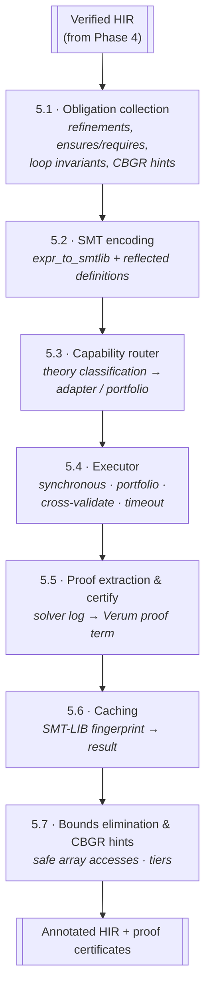

# Verification Pipeline

This page documents the internal architecture of Verum's **SMT
verification subsystem** for compiler developers. The subsystem has
two invocation points in the compilation pipeline:

:::note Solver choice is an implementation detail
The language layer talks to an abstract SMT backend. The current
release dispatches to one or more solver adapters through the capability
router; a Verum-native solver is on the roadmap. Specific solver names
below are notes about the current implementation, not part of Verum's
language contract.
:::

- **Phase 3a — contract verification** — discharges
  `contract#"..."` literals before the type checker sees the
  annotated function.
- **Phase 4 — refinement / dependent verification** — runs as a
  sub-step of semantic analysis (the `DependentVerifier`), collecting
  refinement-type obligations, `ensures` / `requires` clauses, and
  loop invariants.

Results from both flow into Phase 5 VBC codegen as tier-promotion
and bounds-elimination hints. For the user-facing model, see
**[Gradual verification](/docs/verification/gradual-verification)**;
for the solver-selection policy, see **[SMT routing](/docs/verification/smt-routing)**.

## Sub-phase overview

The internal numbering (5.1–5.7) below is the subsystem's own
internal stages — the solver work, not the public pipeline phases.

| Sub-phase | Stage                         | Summary                                                                     |
|-----------|-------------------------------|-----------------------------------------------------------------------------|
| **5.1**   | Obligation collection         | refinement types, `requires` / `ensures`, loop invariants, CBGR hints       |
| **5.2**   | SMT encoding                  | `verum_smt::expr_to_smtlib` + reflected-definition injection                |
| **5.3**   | Capability router             | theory classification → adapter / portfolio                                 |
| **5.4**   | Executor                      | synchronous / portfolio / cross-validate, per-obligation timeout            |
| **5.5**   | Proof extraction & certify    | solver log → Verum proof term (machine-checked if `@verify(certified)`)     |
| **5.6**   | Caching                       | SMT-LIB fingerprint → result, `target/smt-cache/`                           |
| **5.7**   | Bounds elim. & CBGR hints     | inform Phase 6 about provably-safe array accesses and reference tiers       |



## 5.1 — Obligation collection

Walks the typed HIR and emits one `VerificationObligation` per
logical claim that must hold:

Each `VerificationObligation` carries an identifier, a kind, the
in-scope bindings that form its context, a goal predicate, the
source span it was emitted from, and a verify mode (`runtime` /
`static` / `smt` / `portfolio` / `certified`).

The `ObligationKind` enumeration covers every reason an
obligation can be raised:

| Kind                       | Source |
|----------------------------|--------|
| `RefinementWellFormed`     | A refinement type such as `Int { self > 0 }`. |
| `RefinementSubsumption`    | A narrowing / subtyping boundary. |
| `Precondition`             | A `where requires` clause. |
| `Postcondition`            | A `where ensures` clause. |
| `LoopInvariant`            | An `invariant` clause. |
| `LoopTermination`          | A `decreases` clause. |
| `ArrayBounds`              | An `xs[i]` access with non-trivial index. |
| `ContextCapability`        | A capability-subsumption check. |
| `ReferencePromotion`       | Tier-promotion query (`&T → &checked T`). |
| `PatternExhaustiveness`    | A `match` completeness check. |

Sources: `verum_compiler::phases::verification_phase::collect_obligations`
plus hooks in `verum_types::infer` that emit obligations during flow
analysis.

## 5.2 — SMT encoding

`verum_smt::expr_to_smtlib` translates Verum expressions to SMT-LIB
2.6. The translator handles:

- Primitive types → SMT sorts (`Int`, `Real`, `Bool`, `Bitvector N`).
- Algebraic data types → SMT `declare-datatypes`.
- Reflected predicates → `declare-fun` plus a universally-quantified
  defining axiom (no recursive encoding).
- Generic instantiations → monomorphised SMT sorts.
- Cubical / path types → projected to their computational content.

reflected definition injection: the subset of reflected functions reachable from
the current obligation is collected (via transitive closure), and
their bodies emitted as `(define-fun-rec …)` before the obligation's
`(assert (not goal))`.

## 5.3 — Capability router

`verum_smt::capability_router` classifies each obligation by
theory usage. The classifier walks the goal AST and tags it
with the theories it touches; the router then maps the theory
set to an adapter choice.

| AST shape encountered            | Theory tag added |
|----------------------------------|------------------|
| Add / Sub / Mul                  | LIA              |
| Mul of two non-constants         | NIA (nonlinear)  |
| Bit-and / Bit-or / Shift         | BV               |
| Index / Length                   | Array            |
| Concat / Matches                 | String           |
| Forall / Exists                  | Quantifier       |

The mapping from the resulting tag set to an adapter choice
follows the rules below. The router does not name any specific
solver — it picks the highest-ranked adapter whose declared
capabilities cover the tag set. When portfolio mode is in
effect, several adapters race against each other.

| Tag set                                          | Adapter choice |
|--------------------------------------------------|----------------|
| Subset of `LIA ∪ BV ∪ Array ∪ Quantifier`         | Adapter strongest on linear arithmetic. |
| Contains `String` or `NIA`                       | Adapter strongest on those theories. |
| Contains `FiniteModelFinding`                     | Adapter advertising finite-model finding. |
| Otherwise (and portfolio mode on)                 | Race the available adapters in parallel. |
| Otherwise                                         | Default-ranked adapter. |

## 5.4 — Executor

Three execution strategies:

| Mode | Behaviour | Trigger |
|---|---|---|
| **Single** | Dispatch to the router's choice of solver; wait for result | `@verify(formal)` |
| **Portfolio** | Both solvers plus proof search in parallel; first answer wins | `@verify(thorough)` / `@verify(reliable)` |
| **Cross-validate** | Portfolio plus an orthogonal technique; require agreement; error on disagreement | `@verify(certified)` |

Timeout: default 5 s per obligation, configurable via
`verum.toml [verify] solver_timeout_ms`. On timeout, the fallback
strategy (`other-solver` by default) retries with the non-preferred
solver.

## 5.5 — Proof extraction & certification

For `@verify(certified)` obligations:

1. The solver is asked to emit a proof log (`(set-option :produce-proofs true)`).
2. The log is parsed into an AST of inference steps.
3. Steps are normalised into Verum's `ProofTerm` enum:

```verum
type ProofTerm is
    | ByAssumption(obligation_id: UInt64)
    | ByReflexivity
    | BySymmetry(Heap<ProofTerm>)
    | ByTransitivity { left: Heap<ProofTerm>, right: Heap<ProofTerm> }
    | ByInduction    { base: Heap<ProofTerm>, step: Heap<ProofTerm> }
    | ByTactic       { name: Text, args: List<ProofTerm> }
    | ByAxiom        { axiom: Text }
    | BySubst        { lhs: Expr, rhs: Expr, proof: Heap<ProofTerm> }
    | ByCase         { scrutinee: Expr, arms: List<ProofTerm> };
```

4. A verifier checks each step against the axioms + context — this is
   the machine check.
5. On success, the proof term is serialised into the VBC archive's
   `proof_certificates` section.

**Proof erasure** (default, controlled by `[codegen] proof_erasure`):
proof terms are marked and stripped before Phase 5 VBC codegen. The
final binary carries **no runtime proof verification cost** — only
metadata required to reconstruct proofs offline.

## 5.6 — Caching

**Key**: SHA-256 of the SMT-LIB query text plus the solver version
tuple.

**Storage**: `target/smt-cache/`, one file per obligation, value is
`Result` (sat / unsat / unknown / timeout) plus optional proof blob.

**Invalidation**:
- Obligation text change → new hash, no hit.
- Solver upgrade → version-tuple mismatch, invalidate.
- Manual: delete `target/.verum-cache/smt/` or run `verum clean --all`.

Observed hit rate: 60–70% on typical incremental builds.

## 5.7 — Bounds elimination & CBGR hints

Verifier results feed forward into Phase 5 VBC codegen and Phase 6
monomorphization:

- **Array-bounds elimination**: if the solver proves `i < xs.len()`
  for every call site, the bounds check is removed before codegen.
- **Reference-tier promotion**: if escape analysis + refinement
  results prove a `&T` reference is never stored beyond its scope,
  it's promoted to `&checked T` — codegen emits `RefChecked` instead
  of `Ref`, zero-cost.
- **Capability elision**: a `Database with [Read]` that never reaches
  a `Write`-requiring method skips the capability check.

The subsystem's output carries a `HintTable` consumed by VBC codegen
and by later refinement-aware passes (`passes/cbgr_integration.rs`).

## Performance

Empirical on a 50 K-LOC mixed project, Apple M3 Max:

| Theory mix       | Count | Median (ms) |  p95 | Adapter dispatch |
|------------------|------:|------------:|-----:|------------------|
| LIA only         | 2 100 |           8 |   35 | linear-arithmetic adapter |
| LIA + bitvector  |   940 |          14 |   60 | linear-arithmetic adapter |
| LIA + string     |   110 |          45 |  180 | string-capable adapter    |
| Nonlinear (NIA)  |    42 |         320 | 1800 | nonlinear-capable adapter |
| Cubical / path   |    18 |         120 |  400 | cubical tactic → SMT layer |
| **overall**      | 3 210 |          12 |   85 | — |

## Telemetry

`VERUM_SMT_TELEMETRY=1` emits a JSONL stream to
`.verum/telemetry/routing.jsonl`:

```json
{"obligation": "search/postcond#3", "theories": ["lia","array"], "routed": "primary", "ms": 8, "result": "unsat"}
{"obligation": "parse/postcond#1", "theories": ["lia","string"], "routed": "string-capable", "ms": 72, "result": "unsat"}
{"obligation": "crypto/invariant#7", "theories": ["lia","bv"], "routed": "portfolio", "primary_ms": 20, "complementary_ms": 35, "agreed": true}
```

Used to tune the capability router and to detect regressions across
solver upgrades.

## Trusted kernel

Verification has distinct checking paths. The named `CoreTerm` calculus is
checked by `verum_kernel`; portable certificates use the smaller `verum_proof`
calculus with direct and normalization-by-evaluation checkers. Independent Lean
replay covers selected portable certificate forms. A successful check in one
representation does not establish coverage of the other.

### Checking APIs

| Entry point | Role |
|-------------|------|
| `infer` | Infer a named term's type from its context and axiom registry. |
| `verify_full` | Check goal formation and compare the proof type with the goal in the inductive-free fragment. |
| `infer_with_inductives` | Infer with an explicit registry of inductive declarations. |
| `verify_with_inductives` | Check goal formation and a proof against that registry. |
| `replay_smt_cert` | Reconstruct a supported certificate's witness; a solver verdict alone is insufficient. |

Ordinary inductive elimination checks the complete branch family, constructor
ownership, parameter instantiation and recursive hypotheses. Constructors carry
their owning declaration; a local variable with the same spelling is not a
constructor. Recursive fields come from the declaration before parameter
substitution. Nested recursion requires strict positivity checked from the
container's definition, rather than assumed from its name.

Type conversion preserves lexical binding and distinguishes free variables from
bound ones. Type parameters and constructor fields must respect the declaration's
universe. The declaration schema does not yet provide a separate universe
parameter telescope for every datatype parameter.

Declarations are checked before admission. Transparent definitions must have
closed, well-typed bodies at their declared types. Mutually dependent inductives
are admitted atomically after checking field types, universe bounds, parameter
scope and strict positivity against every member of the group. Unknown type
names are errors. Registries retain dependency identities and reject a later
environment that replaces a dependency with another declaration of the same name.

Quotient elimination supports relation-respecting maps into a constant result
type. `QuotElim` carries an explicit `respect` proof: related inputs must produce
equal outputs. Formation, introduction, the case function and that proof are
checked in the kernel. A genuinely dependent quotient motive is refused until
dependent transport coherence is supported. Ordinary transport checks that the
path relates types and that the value inhabits its source type.

### Trusted computing base

A proof claim depends on the checker actually invoked, its implementation and
runtime, and any assumptions supplied through its context or axiom registry.
Independent replay adds a separate check only for the exact statement and
certificate representation it accepts. The Rust compiler, linked dependencies
and execution environment remain part of the native checking boundary.

Tactics, elaboration and solver search are intended to produce evidence for
checking. Their output, an audit entry, or a reconstructed diagnostic proof tree
is not itself proof acceptance. See [proof honesty](/docs/verification/proof-honesty)
for the distinction between evidence and audit metadata.

### Current limitations

Higher inductive elimination is refused because the named-term API does not yet
check the required path-coherence evidence. Its declaration and signature data
must not be interpreted as an accepted higher inductive proof.

The portable certificate calculus supports first-order inductive declarations,
owned constructors, dependent induction and transparent local definitions.
Its substitution and normalization-by-evaluation checkers and the independent
Lean reference checker replay this fragment. Direct recursive fields receive
explicit induction hypotheses. Indexed datatypes, mutually recursive groups,
dependent constructor fields and nested or function-valued recursion are outside
this portable fragment. Named declarations must be translated and checked; they
do not become portable certificates automatically.

Dependent pair introduction uses the expected family: for a goal
`Σ(y : A). B(y)`, the checker verifies the first value at `A` and the second
at `B(first)`. This expected type propagates through functions, arguments,
constructor fields, induction branches and identity elimination. A witness
paired with evidence about a different value is rejected. The portable
substitution and normalization-by-evaluation algorithms and the independent
Lean replay check these rules. This does not establish full checker soundness
or extend the supported inductive declaration grammar.

Execution-policy certificates also check conditional action and continuation
identity, foreign-queue preservation, refusal of credit after error or unwind,
and receipt preservation through interpretation. Failed interpretation remains
inadmissible after later transformations. Transport confirmation and eligibility
for outcome credit are distinct facts. These are general laws of the explicit
policy model, checked alongside altered-policy rejection controls; correspondence
to application code, affine consumption, adapter fidelity and durable delivery
remain separate obligations. The reproducible entry point is
`verification/certificates/check_dispatch_contract.py`.

General finite execution and observation preservation are checked using this
fragment. The statement requires step commutation at every executed admissible
action and preserves visited states, termination and refusal payloads. It does
not establish program selection, learning, actual external effects, or the
correspondence of an arbitrary implementation to those premises. See
[general trace certificates](/docs/architecture/differential-lean-checker#general-trace-certificates).

Named dependent-path formation checks the base path evidence, the family
carrier and both endpoint fibers. Homogeneous reduction requires actual
reflexivity evidence; equal loop endpoints alone are insufficient. See
[cubical reductions](/docs/verification/cubical-hott#computational-univalence)
for the surrounding checker and external-prover boundaries.

Ordinary path transport checks the source value against the path’s left type
and returns its right type. Only reflexive evidence computes to the source
value. Generalized cubical transport with a regularity face is not supported
by this named term.

Named `HComp` and `Glue` are refused because their dimension binding, partial
elements and coherence obligations are not yet checked. Their raw syntax
cannot authorize face reductions. The shared canonical face algebra and its
scoped parser lowering, and the separate De Morgan interval algebra with
explicit dimension scope, do not replace those judgments. Higher inductive
elimination is also refused pending path coherence.

Full soundness of the named calculus and complete end-to-end coverage of
surface proofs have not been established.
External proof export remains subject to the restrictions described in
[proof export](/docs/verification/proof-export).

## See also

- **[SMT integration](/docs/architecture/smt-integration)** — the
  surrounding SMT subsystem (solver adapters, proof search tactics).
- **[Verification → gradual verification](/docs/verification/gradual-verification)** — user-facing model, `@framework(...)`
  attribute, trusted-boundary audit.
- **[Verification → SMT routing](/docs/verification/smt-routing)** —
  solver selection policy.
- **[proof stdlib → PCC](/docs/stdlib/proof#proof-carrying-code--pccvr)** —
  certificate format.
